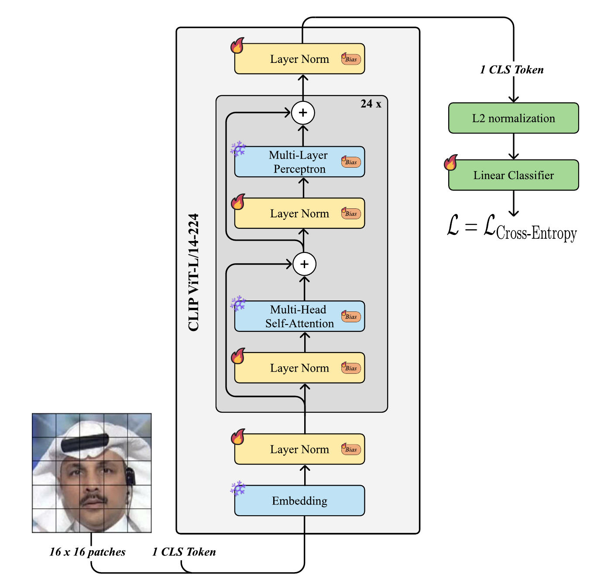
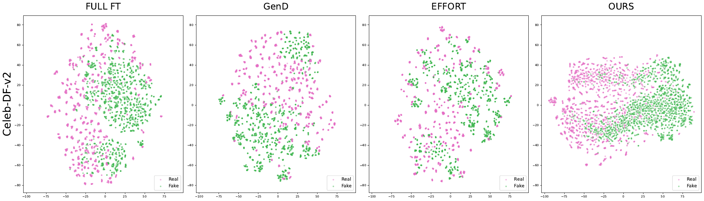
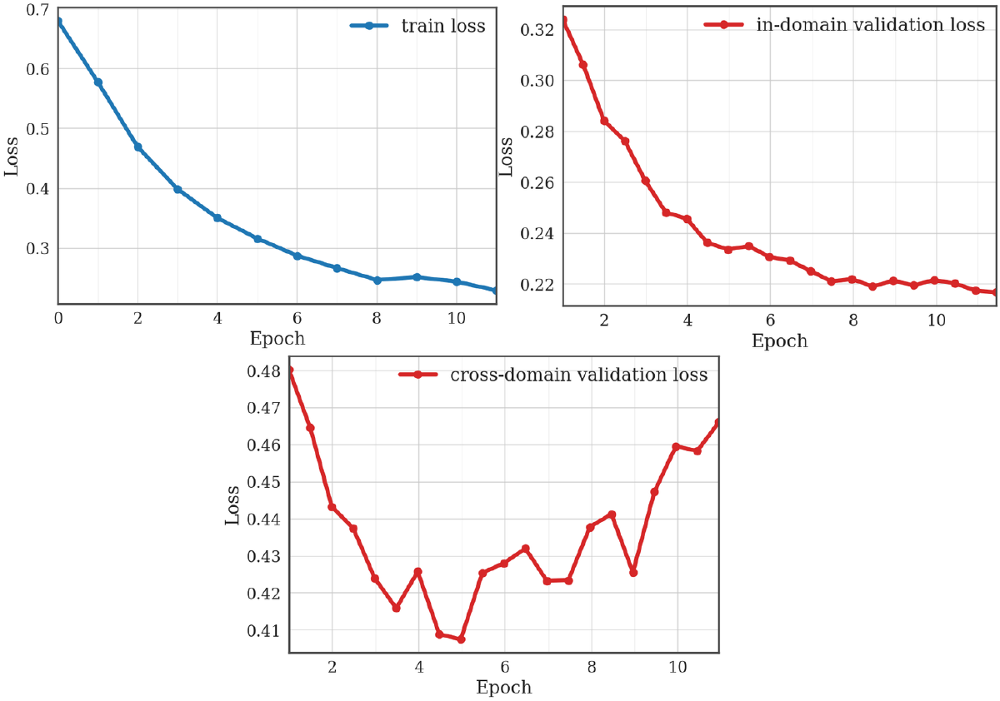
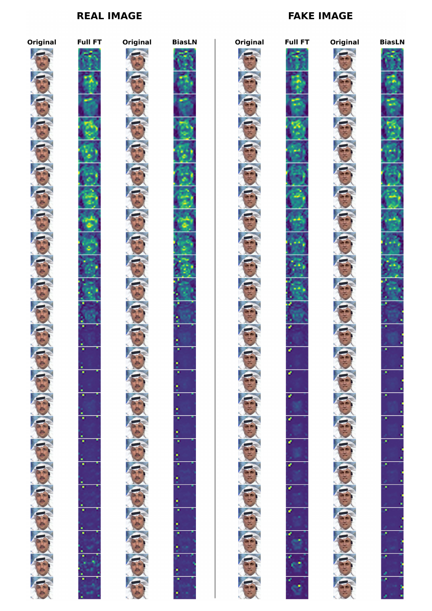

# BiasLN: Efficient Tuning for Generalizable Deepfake Detection Across Benchmarks

**Xuan-Huy Dinh, Minh-Duc Vu, Thanh-Quan Phung-Le, Duc-Thinh Nguyen, Van-Dung Hoang**  
Faculty of Information Technology, Ho Chi Minh City University of Technology and Engineering (HCMUTE)  
*EAI Endorsed Transactions on Smart Cities (under revision)*

<p align="center">
  
</p>
<p align="center"><em>Figure 1. BiasLN. The CLIP ViT-L/14 backbone stays frozen except for its bias terms and LayerNorm parameters. The L2-normalised CLS feature goes to a linear classifier.</em></p>

---

## Abstract

Detectors still struggle to generalise to manipulation techniques they did not see during training. Parameter-Efficient Fine-Tuning (PEFT) is promising, but many PEFT approaches use complex adaptation schemes that can disrupt pre-trained representations or overfit. **BiasLN** is a simple PEFT strategy: it fine-tunes only the **bias terms** and the **LayerNorm affine parameters** of a pre-trained image encoder and adds no new modules. This keeps the visual knowledge learned during pre-training and lets the model pick up subtle manipulation artefacts. BiasLN trains **~0.3M parameters (0.11%)**, adds **no inference cost**, and is competitive across cross-dataset and cross-method benchmarks.

## Contents

- [Method](#method)
- [Results reported in the paper](#results-reported-in-the-paper)
- [Analysis figures](#analysis-figures)
- [Revision: reproducible protocol and new experiments](#revision-reproducible-protocol-and-new-experiments)
- [Installation](#installation)
- [Data](#data)
- [Training and evaluation](#training-and-evaluation)
- [Running on Google Colab](#running-on-google-colab)
- [Repository layout](#repository-layout)
- [Citation](#citation)

## Method

**Feature extractor.** A frozen CLIP ViT-L/14 encoder $g_\theta$ maps an image $\mathbf{x}$ to the post-LayerNorm CLS feature $\mathbf{f} = g_\theta(\mathbf{x}) \in \mathbb{R}^{1024}$. The projection, attention and feed-forward weight matrices are all frozen.

**BitFit (bias-only tuning).** For every linear layer, $\mathbf{h} = \mathbf{W}_{\text{pt}}\mathbf{x} + \mathbf{b}_{\text{tuned}}$: the weight stays at its pre-trained value and only the bias is optimised.

**LayerNorm tuning.** For every LayerNorm, only the affine scale and shift are optimised:

$$\mathrm{LN}_{\text{tuned}}(\mathbf{h}) = \gamma_{\text{tuned}} \odot \frac{\mathbf{h}-\mu}{\sqrt{\sigma^2+\epsilon}} + \beta_{\text{tuned}}$$

**Head and objective.** The feature is L2-normalised, $\tilde{\mathbf{f}} = \mathbf{f}/\lVert\mathbf{f}\rVert_2$, and classified by a linear head $h_\phi$ (labels: 0 = real, 1 = fake). The model is trained with class-weighted, label-smoothed cross-entropy. The weights are $w_{\text{fake}}:w_{\text{real}} = 2:1$, the smoothing is $\alpha=0.1$, and the smoothed target is $q_{i,c} = (1-\alpha)\mathbb{1}[c=y_i] + \alpha/C$:

$$\mathcal{L}_{\text{ce}} = \frac{\sum_{i} \sum_{c} -\,w_c\, q_{i,c} \log p_{i,c}}{\sum_i w_{y_i}}$$

This is exactly what `torch.nn.CrossEntropyLoss(weight=w, label_smoothing=α)` computes. `tests/test_biasln.py` checks it.

**Trainable parameters (CLIP ViT-L/14).** The counts are checked by a unit test.

| Component | Parameters |
|---|---:|
| All bias vectors (incl. LayerNorm β) | 272,384 |
| LayerNorm γ (50 LayerNorms × 1024) | 51,200 |
| Linear head (1024 → 2) | 2,050 |
| **Total** | **325,634 (0.107%)** |

**Training setup.** FF++ c23 is used for training, with 8 frames per video for training and 32 for testing, and 224×224 RetinaFace-aligned crops with a 1.3× margin, following DeepfakeBench. Augmentations are flip, rotation ±10°, Gaussian blur, brightness/contrast and JPEG compression with quality 40–100. The optimiser is Adam with lr 3e-4, betas (0.9, 0.999) and no weight decay, on a cosine schedule ($T_{\max}=10$, min lr 1e-5). Training runs for 10 epochs at batch size 32. See [`training/config/detector/BiasLN.yaml`](training/config/detector/BiasLN.yaml).

## Results reported in the paper

All numbers are video-level AUC for detectors trained on FF++ c23. The tables below reproduce the submitted manuscript. The [revision section](#revision-reproducible-protocol-and-new-experiments) explains how these numbers are being re-measured under a stricter protocol.

**In-domain (FF++ c23)**

| Method | DF | F2F | FS | NT | Mean |
|---|---|---|---|---|---|
| ForAda | 99.7 | 97.0 | 98.6 | 91.9 | 96.8 |
| Effort | 99.4 | 93.2 | 98.4 | 84.6 | 93.9 |
| GenD (PE) | 99.7 | 99.3 | 99.1 | 97.5 | 98.9 |
| **BiasLN** | **99.9** | **99.9** | **99.9** | **98.0** | **99.4** |

**Cross-dataset (Protocol-1) and cross-method on DF40 (Protocol-2)**

| Method | Params | CDF-v2 | DFD | DFDC | DFDCP | UADFV | Avg(D) | UniFace | BlendFace | E4S | FaceDancer | FSGAN | InSwap | SimSwap | Avg(M) |
|---|---|---|---|---|---|---|---|---|---|---|---|---|---|---|---|
| Effort | 0.19M | 0.956 | 0.965 | 0.843 | 0.909 | 0.974 | 0.9294 | 0.962 | 0.873 | 0.983 | 0.926 | 0.957 | 0.936 | 0.926 | 0.9376 |
| ForAda | 5.7M | 0.957 | 0.972 | **0.872** | **0.928** | **0.994** | 0.9446 | 0.950 | 0.880 | 0.968 | 0.945 | 0.975 | 0.948 | 0.912 | 0.9397 |
| GenD | 0.1M | 0.960 | 0.970 | 0.870 | 0.917 | 0.992 | 0.9418 | **0.983** | 0.933 | **0.988** | 0.954 | **0.982** | **0.965** | 0.958 | 0.9661 |
| **BiasLN** | 0.3M | **0.971** | **0.977** | 0.862 | 0.925 | 0.992 | **0.9454** | 0.982 | **0.944** | **0.988** | **0.983** | 0.975 | 0.956 | **0.963** | **0.9701** |

The full table, which also covers F3Net, SPSL, SRM, CORE, RECCE, SLADD, SBI, UCF, IID, LSDA, ProDet and CDFA, is in the paper.

**Ablation (cross-dataset video AUC)**

| PEFT | L2 norm | CDF-v2 | DFDC | DFD | UADFV | Avg |
|---|---|---|---|---|---|---|
| Full FT | No | 0.655 | 0.560 | 0.495 | 0.624 | 0.5835 |
| LoRA | No / Yes | 0.941 / 0.893 | 0.844 / 0.819 | 0.977 / 0.955 | 0.988 / 0.986 | 0.9375 / 0.9133 |
| BitFit | No / Yes | 0.953 / 0.927 | 0.846 / 0.826 | 0.969 / 0.961 | 0.996 / 0.994 | 0.9410 / 0.9270 |
| LayerNorm | No / Yes | 0.931 / 0.945 | 0.840 / 0.866 | 0.966 / 0.973 | 0.993 / 0.998 | 0.9325 / 0.9455 |
| **BitFit + LN** | Yes | **0.971** | **0.866** | **0.977** | 0.992 | **0.9515** |

## Analysis figures

<p align="center"></p>
<p align="center"><em>Figure 2. t-SNE of Celeb-DF-v2 features for Full FT, GenD, Effort and BiasLN.</em></p>

<p align="center"></p>
<p align="center"><em>Figure 3. Training loss on FF++ and validation loss on a held-out cross-domain subset. Lower in-domain loss does not mean better transfer.</em></p>

<details>
<summary>Figure 4. Self-attention maps for all 24 CLIP blocks, Full FT vs. BiasLN (click to expand)</summary>
<p align="center"></p>
</details>

## Revision: reproducible protocol and new experiments

The reviewers raised several points. The repository now has code that answers each of them; [`docs/REBUTTAL.md`](docs/REBUTTAL.md) maps every comment to the change that addresses it.

| Reviewer concern | What the code now does |
|---|---|
| Checkpoint selected on a Celeb-DF-v2 subset, which is also a test set | `--selection val` (default) selects on the **FF++ val split**. `--selection last` selects no checkpoint and uses the final epoch. `test_oracle` is kept only to *measure* how much test-set selection inflates results (`scripts/eval_epochs.sh`). `tools/check_splits.py` checks that the selection data shares no frames or videos with any test set. |
| Baselines were not run under the same protocol | GenD and Effort are re-implemented in the same detector class ([`BiasLN.py`](training/detectors/BiasLN.py)) and run with the same data, splits, selection rule and evaluation. |
| No standard deviations or significance tests | `scripts/run_protocol.sh` runs 5 seeds. [`tools/stats.py`](tools/stats.py) reports mean ± std, 95% CIs, paired t-tests and sign-flip tests across seeds (Holm-corrected), per-seed DeLong tests and bootstrap CIs of ΔAUC on the same test videos. |
| Training cost, memory and inference cost not measured | [`tools/benchmark_efficiency.py`](tools/benchmark_efficiency.py) reports train ms/step, images/s, peak memory, inference latency and throughput, GFLOPs and checkpoint size. Every training run also logs time and peak memory per epoch in `run_info.json`. |
| Ablation does not isolate each component | [`scripts/run_ablation.sh`](scripts/run_ablation.sh) varies one factor at a time on the same pipeline: linear probe, full FT with its own lower backbone LR, LoRA, BitFit, LN and BitFit+LN, each with and without L2 norm, plus BiasLN without class weights and without label smoothing. |
| Loss equation omits the class weights | The equation above is the exact implemented loss and is unit-tested. |

Results of the revision runs are collected in [`docs/REVISION_RESULTS.md`](docs/REVISION_RESULTS.md).

**Improved variant.** `BiasLN_Asy.yaml` adds an asymmetric supervised contrastive loss: real–real pairs are pulled together, fake–real pairs are pushed apart, and fake–fake pairs are left free so that diverse forgeries are not collapsed into one cluster. The variant stays within the PEFT budget; the projection head is used only during training.

## Installation

```bash
git clone https://github.com/dinhxuanhuy/BiasLN.git && cd BiasLN
pip install -r requirements.txt        # torch>=1.12, transformers, albumentations (1.x or 2.x), ...
python -m pytest -q tests/test_biasln.py
```

## Data

The data follows the [DeepfakeBench](https://github.com/SCLBD/DeepfakeBench) pre-processing and JSON format:

```
datasets/rgb/<Dataset>/...                 extracted face frames
preprocessing/dataset_json/<Dataset>.json  {dataset: {label: {train|val|test: {video: {label, frames}}}}}
```

Cross-dataset: FaceForensics++ (training), Celeb-DF-v2, DeepFakeDetection, DFDC, DFDCP, UADFV.
Cross-method: seven DF40 face-swap subsets (`uniface_ff`, `blendface_ff`, `e4s_ff`, `facedancer_ff`, `fsgan_ff`, `inswap_ff`, `simswap_ff`).

## Training and evaluation

```bash
# BiasLN, paper hyper-parameters, checkpoint selected on FF++ val
python training/train.py --detector_path training/config/detector/BiasLN.yaml --seed 1024

# Evaluate the selected checkpoint and write metrics.json + per-video scores
python training/test.py --detector_path training/config/detector/BiasLN.yaml \
  --weights_path logs/<run>/test/FaceForensics++/ckpt_best.pth \
  --test_dataset Celeb-DF-v2 DeepFakeDetection DFDC DFDCP UADFV uniface_ff blendface_ff \
                 e4s_ff facedancer_ff fsgan_ff inswap_ff simswap_ff \
  --out_dir results/val/biasln/seed1024

# Any config key can be overridden from the command line
python training/train.py --detector_path training/config/detector/BiasLN.yaml \
  --opts tuning_mode=lora lora_rank=8 l2_norm=false optimizer.adam.lr=1e-4

# Full studies (resumable)
scripts/run_protocol.sh                     # BiasLN vs GenD vs Effort, 5 seeds
scripts/run_ablation.sh                     # one-factor ablation, 3 seeds
SELECTION=last scripts/run_protocol.sh      # target-agnostic protocol
scripts/eval_epochs.sh logs/val/biasln_s1024   # per-epoch curves + oracle gap
bash scripts/benchmark.sh                   # efficiency table
python tools/stats.py --results results/val --models biasln gend effort --reference biasln
```

Checkpoints store only the trained tensors: about 1.3 MB for BiasLN, compared with about 1.2 GB for a full CLIP-L state dict. `test.py` restores the frozen weights from the pretrained backbone.

## Running on Google Colab

The project uses the [Colab CLI](https://pypi.org/project/google-colab-cli/). The agent skill is in [`.claude/skills/colab-operator`](.claude/skills/colab-operator/SKILL.md).

```bash
scripts/colab/launch.sh new A100            # allocate a GPU VM
colab drivemount -s biasln                  # once, interactive (Drive holds MyDrive/rgb, MyDrive/df40)
scripts/colab/launch.sh push                # upload this working tree to /content/BiasLN
scripts/colab/launch.sh setup               # extract data from Drive, install deps, audit splits
scripts/colab/launch.sh start scripts/run_protocol.sh AMP=bf16
scripts/colab/launch.sh status              # poll
scripts/colab/launch.sh fetch               # download results/
scripts/colab/launch.sh stop                # release the VM
```

Results are synced to `MyDrive/BiasLN_runs` after every finished (model, seed) pair. Re-running `start` resumes from where it stopped.

## Repository layout

```
training/
  detectors/BiasLN.py        BiasLN + GenD + Effort + all ablation modes (one class)
  detectors/peft.py          parameter selection: frozen | bitfit | ln | bitfit_ln | lora | full
  detectors/losses.py        weighted CE (explicit), asymmetric SupCon, GenD align/uniform
  config/detector/           BiasLN.yaml, BiasLN_Asy.yaml, GenD.yaml, Effort.yaml (+ earlier variants)
  train.py / test.py         selection protocols, compact checkpoints, per-video score dumps
tools/                       stats.py, benchmark_efficiency.py, check_splits.py, epoch_table.py
scripts/                     run_protocol.sh, run_ablation.sh, eval_epochs.sh, benchmark.sh, colab/
docs/                        REBUTTAL.md, REVISION_RESULTS.md, images/
```

Other detectors under `training/detectors/` (BiasConsistency, BiasRealAnchor, BiasLoraAsy, ...) are earlier exploratory variants and are not part of the paper.

## Citation

```bibtex
@article{dinh2026biasln,
  title   = {BiasLN: Efficient Tuning for Generalizable Deepfake Detection Across Benchmarks},
  author  = {Dinh, Xuan-Huy and Vu, Minh-Duc and Phung-Le, Thanh-Quan and Nguyen, Duc-Thinh and Hoang, Van-Dung},
  journal = {EAI Endorsed Transactions on Smart Cities},
  year    = {2026},
  note    = {Under revision}
}
```

This codebase builds on [DeepfakeBench](https://github.com/SCLBD/DeepfakeBench). The baselines follow [GenD](https://github.com/yermandy/GenD) and [Effort](https://github.com/YZY-stack/Effort-AIGI-Detection).
